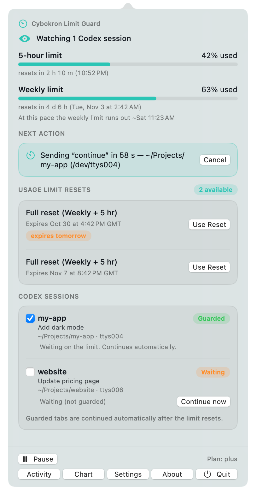
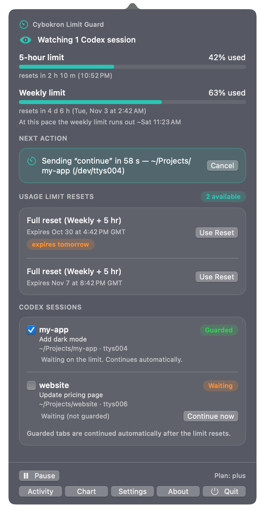
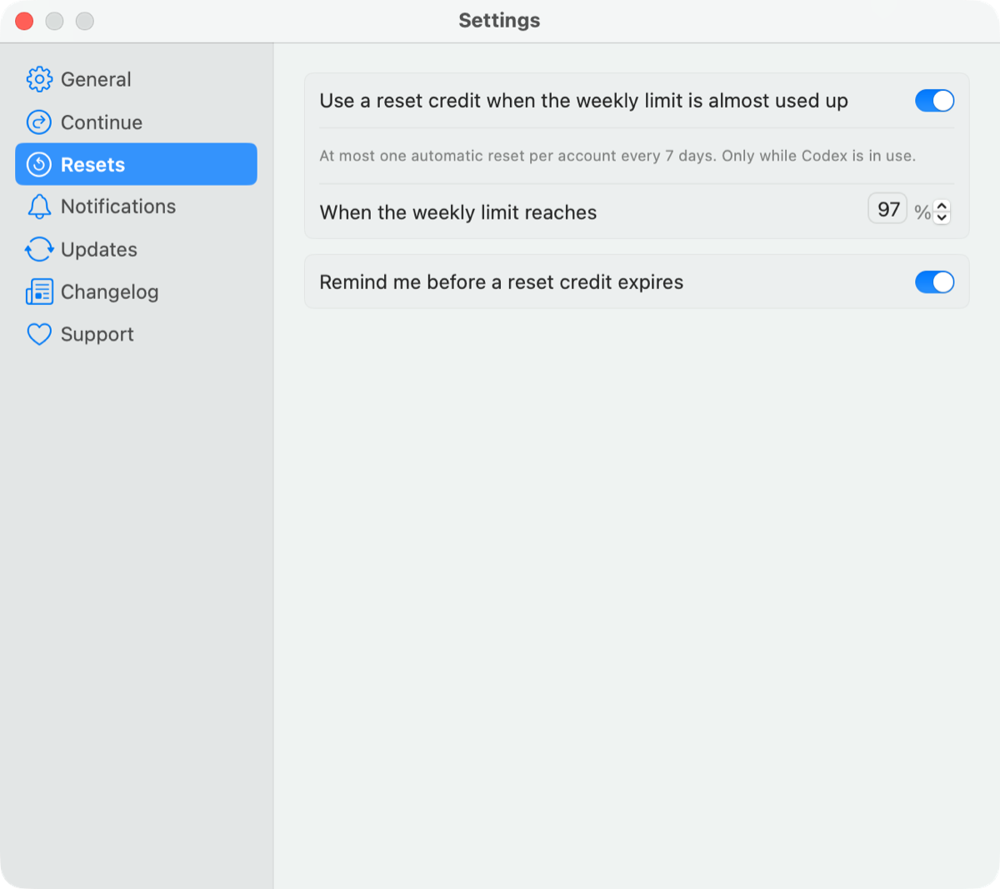
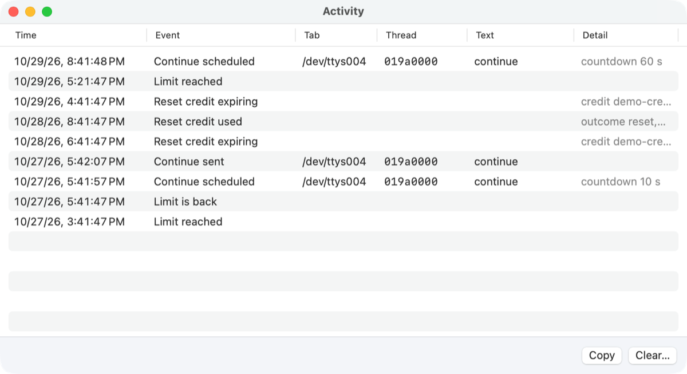
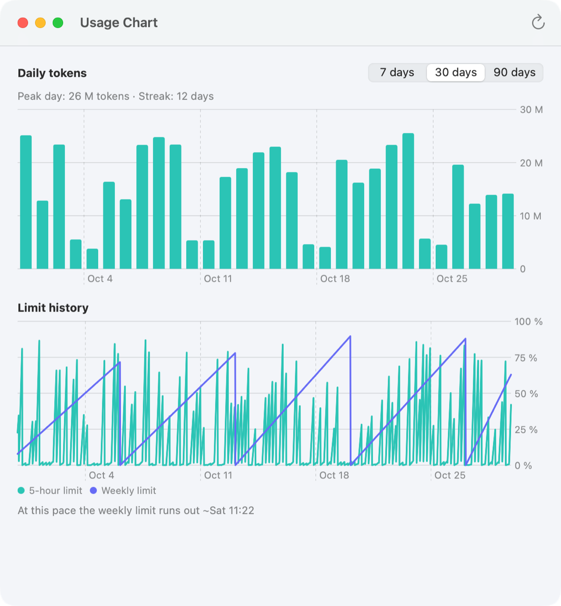
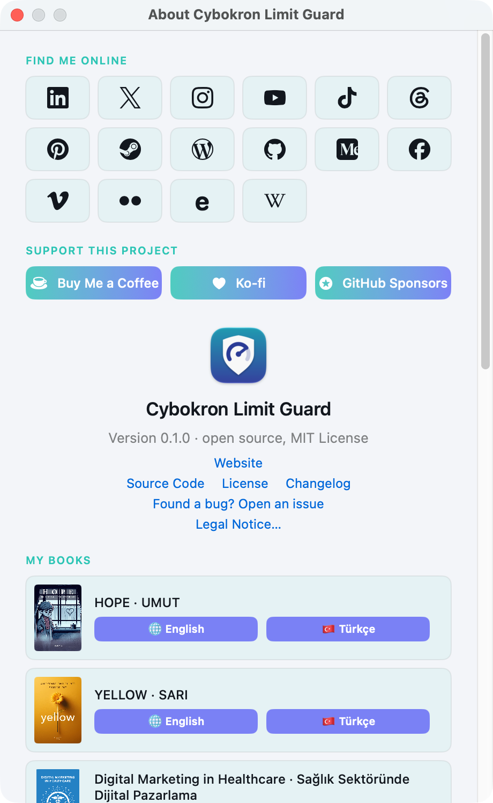

# Cybokron Limit Guard

A free, open-source macOS menu bar app that watches your Codex CLI usage limits, continues
interrupted Codex sessions once the limit resets, and — only if you allow it — uses a reset credit
before the weekly limit runs out.

> Status: Phase 1 (v0.1.0, in development). Codex CLI is the supported agent; English and Turkish.

## Screenshots

<p align="center">
  
  &nbsp;
  
</p>

<table>
  <tr>
    <td width="50%"></td>
    <td width="50%"></td>
  </tr>
  <tr>
    <td align="center">Settings → Resets</td>
    <td align="center">Activity</td>
  </tr>
  <tr>
    <td width="50%"></td>
    <td width="50%"></td>
  </tr>
  <tr>
    <td align="center">Usage chart</td>
    <td align="center">About</td>
  </tr>
</table>

The data in the screenshots is made up. All screenshots, in light and dark mode, are in
[docs/screenshots](docs/screenshots/README.md).

## Features

- **Usage at a glance**: the 5-hour and weekly limits as bars with their reset times, in the popover
  and (optionally) as a percentage next to the menu bar icon. The icon is a gauge; the figure shown
  is the more critical of the two windows, orange from 80 % and red from 95 % or when the limit is
  reached.
- **Reset credits panel**: every unused usage-limit reset credit with its expiry date and a
  **Use Reset** button. A manual reset always asks first and is never done twice by accident.
  Credits that expire within 24 hours are sorted first and can trigger a reminder.
- **Auto-continue**: when a Codex turn was cut off by the usage limit, Limit Guard waits until
  usage is allowed again and sends a short "continue" message to that very conversation — in the
  conversation's language (`continue`, `devam et`; editable). A countdown (default 10 s) lets you
  cancel, and a task that finished normally is never continued.
- **Loop guard**: at most 3 continues in a row (editable), a minimum gap between them, and a
  runaway brake that stops after three auto-continued turns that each ended within a minute.
- **Reset credit auto-use (off by default)**: when enabled, spends one reset credit when the weekly
  limit is almost used up (default 97 % used) so a long task is not interrupted — at most one
  automatic use per account every 7 days, only while Codex is in use, and never when the weekly
  window resets by itself within 12 hours.
- **Forecast**: from recent samples, "at this pace the weekly limit runs out around Fri 14:00".
- **Usage chart**: daily token use for the last 7, 30 or 90 days and the history of both limit
  windows.
- **"Limit is back"** notification, expiry reminders, a keep-awake option while a continue is
  pending, an Activity log, Pause/Resume for everything automatic, launch at login.
- **Diagnostics**: Settings → General → Run Diagnostics checks Codex, sign-in, the app-server, the
  protocol, notifications and your approval policy, and copies a report without secrets.
- Automatic updates from GitHub Releases (checksum-verified), an **Other Versions…** window to go
  back to an earlier release, and a changelog.

Everything Limit Guard knows about your account comes from Codex's own local app-server, and the
continue message is delivered through the same app-server — no screen reading, no typing into
Terminal, no Automation or Accessibility permission.

## Important notice

Shown on first run; nothing automatic happens until you accept it.

> **Before you use Cybokron Limit Guard**
> This is an independent, open-source tool. It is not made, endorsed or supported by OpenAI or
> any other AI platform. It acts on your behalf: it can send messages into your Codex sessions
> and, only if you allow it, redeem your usage-limit reset credits. Automated use, or a fault in
> this tool, may conflict with the usage policies of your AI platform account, which may then
> apply restrictions, limits or suspensions to your account. You use this tool at your own
> risk; the software is provided "as is", without warranty of any kind (MIT License). Review
> your platform's terms before enabling automatic actions.

## Privacy

Everything stays on your Mac. The app reads Codex's local session files only to detect stops and
the conversation language; it never copies conversation text into its own files (the activity log
stores only the continue text it sent), never reads `auth.json`, and sends nothing anywhere except
Codex's own app-server and GitHub (update check and changelog). No analytics. See
[SECURITY.md](SECURITY.md).

## Download

Get the latest universal disk image (`Cybokron-Limit-Guard-<version>-universal.dmg`) from the
[releases page](https://github.com/ercanatay/cybokron-limit-guard/releases), open it and drag the
app to Applications. Releases are Developer ID signed and notarized.

## Requirements

- macOS 14 Sonoma or later (Apple silicon or Intel)
- [Codex CLI](https://github.com/openai/codex) signed in with ChatGPT (`codex login`)
- To build: Xcode 16 or later, or just the Command Line Tools

## Building

The Xcode project is generated with [XcodeGen](https://github.com/yonaskolb/XcodeGen) from
`project.yml`; the generated `CybokronLimitGuard.xcodeproj` is committed, so XcodeGen is only
needed after changing `project.yml` or adding/removing files.

```sh
git clone https://github.com/ercanatay/cybokron-limit-guard.git
cd cybokron-limit-guard

scripts/test.sh                              # unit tests (SwiftPM)
scripts/build-app.sh debug                   # build/debug/Cybokron Limit Guard.app
UNIVERSAL=1 scripts/build-app.sh release     # universal release build
```

Tests never call the real reset-credit endpoint; every spend path runs against a fake app-server.

## Roadmap

- **Phase 1 (v0.1.0)**: Codex CLI, delivery through the Codex app-server, English + Turkish.
- **Phase 2**: more terminals and editors (iTerm2, Ghostty, VS Code, Cursor), and a keystroke
  fallback when the app-server is not reachable.
- **Phase 3**: the Codex desktop app.
- **Phase 4**: other agents (Claude Code, OpenCode).
- **Phase 5**: several accounts at once.

The full design is in [docs/design/limit-guard-spec.md](docs/design/limit-guard-spec.md).

## Project layout

| Path | Contents |
| --- | --- |
| `Sources/LimitGuardCore` | Logic with no UI: app-server client, limit and credit models, session scanning, policies, persistence, diagnostics, updates |
| `Sources/CybokronLimitGuard` | App: AppKit lifecycle, menu bar item, popover, SwiftUI windows, notifications |
| `Tests/LimitGuardCoreTests` | swift-testing unit tests for the core |
| `Resources` | `Info.plist`, asset catalog, string tables (`en.lproj`, `tr.lproj`) |
| `scripts` | Build, test, DMG, notarization and icon scripts |

The app icon is drawn by `scripts/generate-app-icon.swift` from plain shapes.

## Made by

Made by [Ercan ATAY](https://ercanatay.com) / [Cybokron](https://cybokron.com). See also
[Cybokron Dock Groups](https://github.com/ercanatay/cybokron-dock-groups). Questions and ideas:
[Discussions](https://github.com/ercanatay/cybokron-limit-guard/discussions); bugs:
[Issues](https://github.com/ercanatay/cybokron-limit-guard/issues).

## License

MIT — see [LICENSE](LICENSE).
